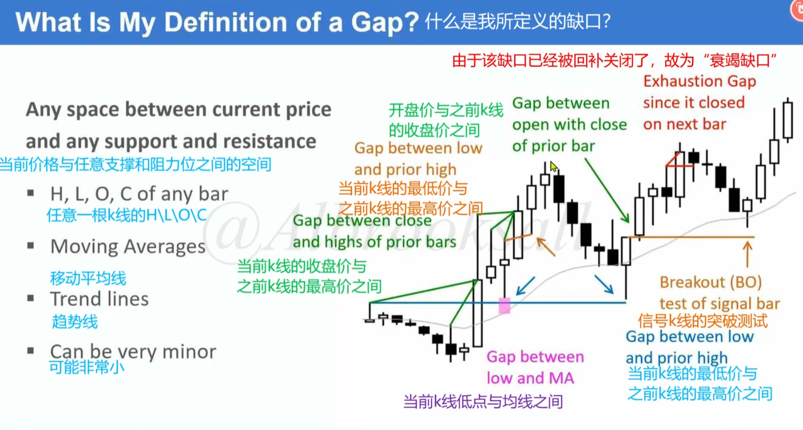
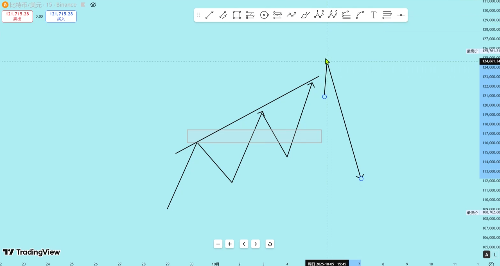
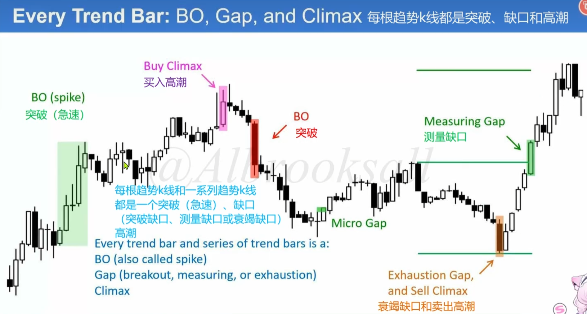
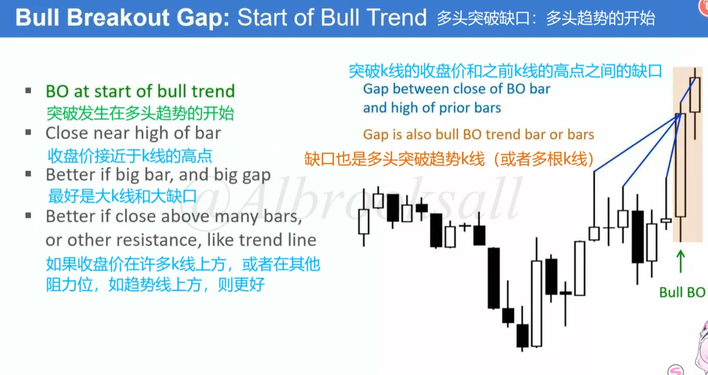
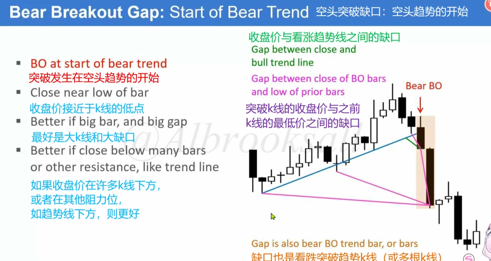
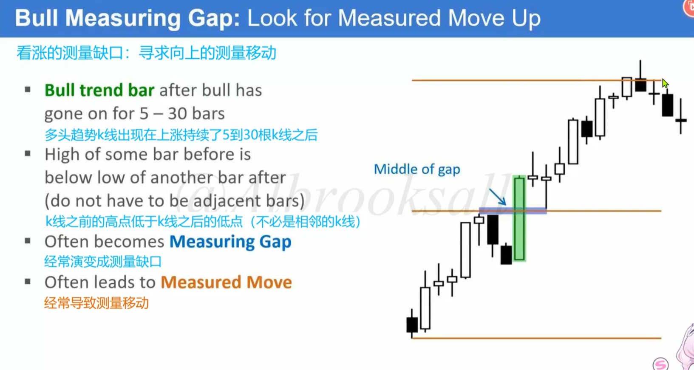

1. 缺口的定义：当前价格与任意支撑阻力之间的空间
    - 当前k线的收盘价与之前k线的最高价之间
    - 当前k线的最低价与之前k线的最高价之间
    - 开盘价与之前k线的收盘价之间
    - 当前k线低点与均线、趋势线之间
    
2. 缺口起到支撑的作用，趋势留下缺口后，再次突破，当回到缺口时会有人打赌趋势延续
3. 当上一波的高点和这一波的低点相交了（没有形成缺口），那么意味着趋势变弱，当形成三推后，是有理由做空的。思维：看到粘连、想到通道、看到通道，想到三推或者通道过冲
    
4. 每根趋势k都是突破、缺口、高潮
    
5. 突破发生在趋势的开始，连续干翻了很多个波段起始点的缺口，往往时趋势的开始
    
    
6. 缺口的测量移动
    - 当两波段不相交时，取缺口中间值与前一波段起点翻倍作为目标止盈
    